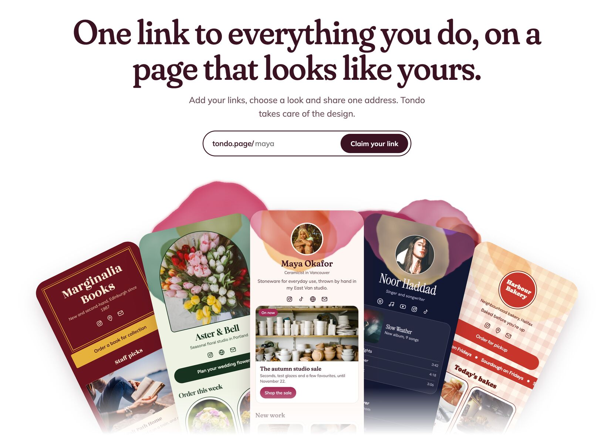
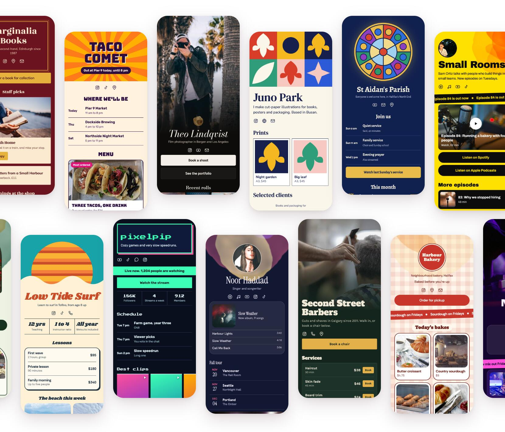
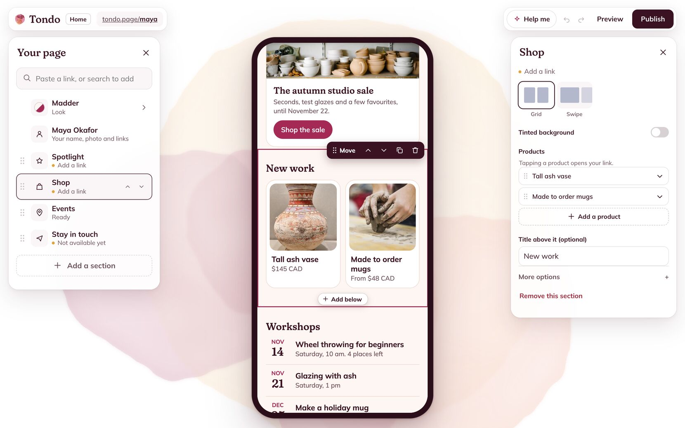
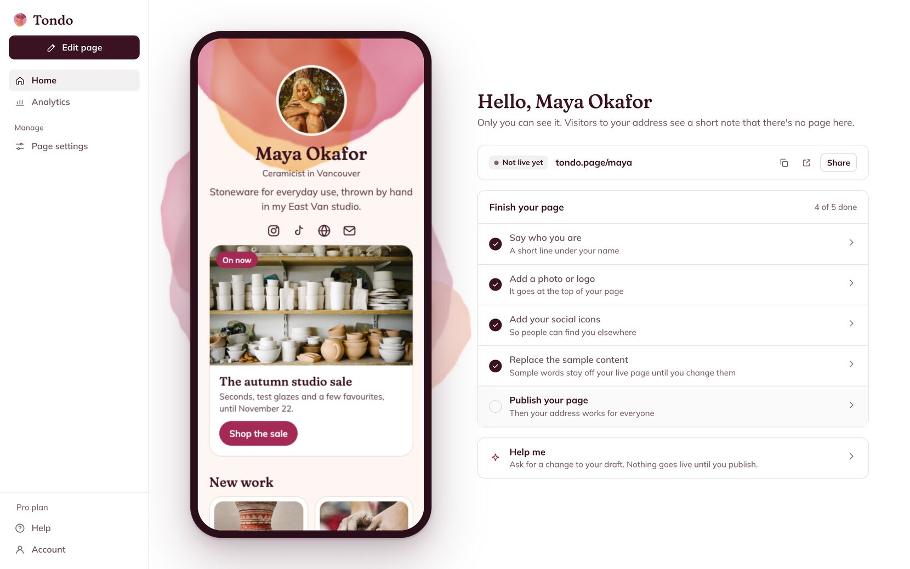

<p align="center">
    <picture>
        <source media="(prefers-color-scheme: dark)" srcset=".github/readme/logo-dark.png">
        
    </picture>
</p>

<p align="center">
    Tondo gives a person or a team one address, such as <code>tondo.page/maya</code>, for a page of links with a designed look.
</p>

<p align="center">
    
</p>

Tondo isn't launched yet. Nothing is deployed, so `tondo.page` doesn't serve this product, and it has no customers. The images below come from the code in this repo running locally. The people and businesses on the example pages are fictional, and so are their prices, dates and numbers.

## Page looks

A page's look sets its colours, type, shapes and art. The repo has 50 looks and 50 example pages, saved as ordinary page documents and drawn by the same renderer that draws a published page.

<p align="center">
    
</p>

The marketing site's gallery shows all 50. The example photos are CC0 or public domain demo images from Openverse, listed in [`packages/brand/photos/CREDITS.md`](packages/brand/photos/CREDITS.md), and they still need checking against their sources before any public launch.

## The builder

The builder shows the page on a phone, with the sections on the left and the selected section's settings on the right. You can reorder sections, change a section's layout and undo a change. The page is saved as a draft, and nothing goes live until you publish.

<p align="center">
    
</p>

The amber notes in the section list show what's left to do. Here, Spotlight and Shop still need links, and "Stay in touch" is marked as not available yet because collecting sign-ups isn't built.

## Home

Home is where you land after signing in. It shows your page on a large phone, your address and whether the page is live, a short checklist, and your numbers once the page has visits.

<p align="center">
    
</p>

## What's here

- **50 looks**, each adjustable with your own colours, fonts and backgrounds.
- **18 kinds of section you can use today**, including links, photos, a shop, services and prices, bookings, events, video and music, questions, a team and tabs. Four more are defined but not available yet: sign-ups and forms, file downloads, a tip jar and embeds.
- **Help me**, a chat panel in the builder that runs on Gemini. It edits a working copy of your page through typed tools, applies the result as one change you can undo, and can't publish. It stays hidden unless `GOOGLE_API_KEY` is set.
- **Accounts, publishing and statistics**: sign-in through Neon Auth, checks before going live, public pages with no JavaScript, and view and click counts.

## What's still being built

- **Teams.** There's a plan in [`.docs/teams-implementation.md`](.docs/teams-implementation.md), and no team code yet, although the marketing site already has a page describing them.
- **Several pages.** The data model and routes give each page its own address, but the interface only reaches one page. Home's page switcher isn't built yet.
- **Plans and billing.** The billing code runs against a stand-in for Stripe and stays off unless `PLANS_ON` is set. There's no Stripe account yet, and the code is being changed to match plans decided recently, described in [`.docs/plans.md`](.docs/plans.md).
- **The four sections that aren't available yet.** Collecting sign-ups and form replies, for example, needs an email provider and storage.
- **Deployment.** The Render and Neon setup is written down in [`.docs/deploy.md`](.docs/deploy.md), but it hasn't been tried. Sign-in has only been tested against a local stand-in for Neon Auth's API.

## How it's built

Tondo is a TypeScript pnpm and Turbo monorepo. Shared packages are imported straight from source, and `boundaries.json` says what each workspace may import, which keeps the renderer free of editor and server code.

| Workspace           | What it does                                                                        |
| ------------------- | ----------------------------------------------------------------------------------- |
| `apps/server`       | Hono: the API, public pages, the Neon Auth proxy and, in production, the built apps |
| `apps/editor`       | SolidJS and Vite: Home, the start flow and the builder                              |
| `apps/marketing`    | Astro, with static output: the site and the example pages                           |
| `packages/page`     | The page schema, address rules, link safety and one file per block                  |
| `packages/render`   | Page to HTML and CSS, the painted art and one file per look                         |
| `packages/contract` | API routes and response schemas                                                     |
| `packages/db`       | Drizzle schema, migrations and queries for Postgres                                 |
| `packages/brand`    | Tondo's own colours and CSS tokens, and the demo photos                             |

Data is saved in Postgres, with each page stored as a JSON document. Photos go to S3-compatible object storage, which is RustFS in Docker locally and is planned to be Cloudflare R2 in production.

## Running it locally

You'll need Node 22.12 or newer, pnpm and Docker.

```sh
pnpm install
pnpm services:up
pnpm db:migrate
pnpm db:seed
pnpm dev
```

| Port   | Service                   | Address                                              |
| ------ | ------------------------- | ---------------------------------------------------- |
| `8100` | Editor                    | `http://localhost:8100`                              |
| `8101` | Server                    | `http://localhost:8101/sample` shows the seeded page |
| `8102` | Postgres, in Docker       |                                                      |
| `8103` | Marketing site            | `http://localhost:8103`                              |
| `8105` | Object storage, in Docker |                                                      |

The site and the seeded page run without any keys. To sign in and use the builder, you'll need a Neon Auth project, with its values in a `.env` file copied from `.env.example`. Until then, sign-in says it isn't set up. Help me needs a `GOOGLE_API_KEY` in the same file, and you should use a paid-tier key for anything real, because Google can use free-tier content to improve its products.

`pnpm check` runs formatting, the import and naming guards, lint, types and unit tests. `pnpm e2e` builds the apps and runs the Playwright tests on ports 8108 and 8109, with local stand-ins for Neon Auth, Stripe and object storage, so it needs no accounts. `pnpm examples:images` redraws the screenshots of the example pages.

Product and design documents are in [`.docs`](.docs/README.md).
